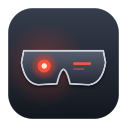
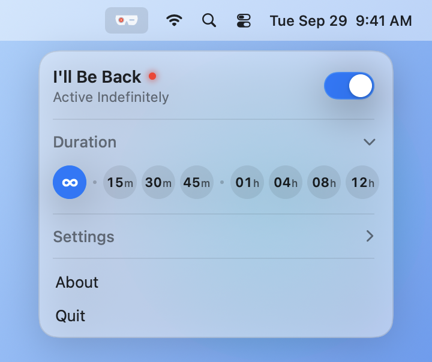
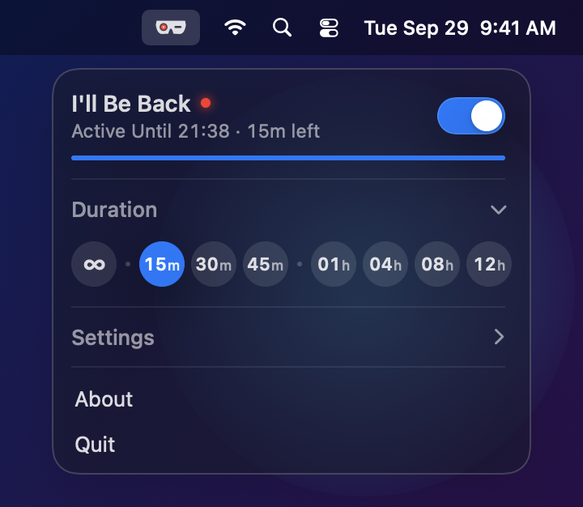
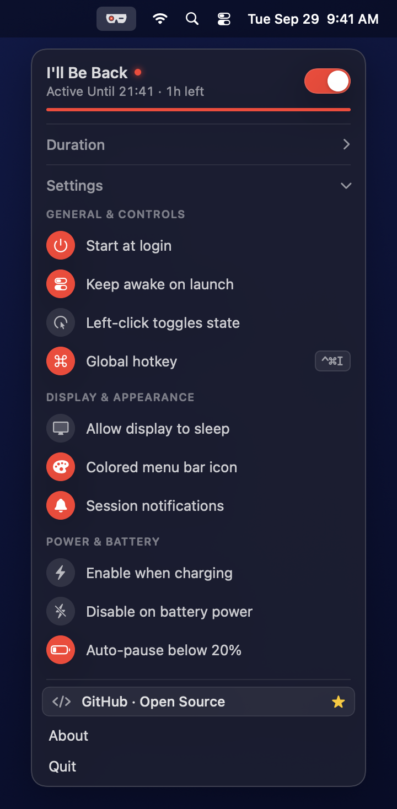

# I'll Be Back — macOS Keep-Awake Menu Bar Utility 🕶️🔴

<p align="center">
  
</p>

<p align="center">
  <strong>A lightweight, native macOS Control Center menu bar utility that prevents your MacBook from sleeping.</strong><br/>
  Built with <code>Swift 6</code>, <code>SwiftUI</code>, and <code>AppKit</code>. 100% Free & Open Source (MIT License).
</p>

<p align="center">
  <a href="https://buymeacoffee.com/alexandrofc">
    
  </a>
</p>

<p align="center">
  
  &nbsp;&nbsp;
  
  &nbsp;&nbsp;
  
</p>

---

## ✨ Features

- **Cyber-Visor Menu Bar Icon** — Clean template sunglasses when inactive; lights up with a glowing **red Terminator dot** in the left lens when active.
- **8 One-Click Duration Presets** — `∞` (Indefinitely) · `15m` `30m` `45m` · `1h` `4h` `8h` `12h` with a live countdown progress bar and exact end-time subtitle (`Active Until 22:45 · 15m left`).
- **Smart Power & Battery Automation**:
  - **Enable when charging** — Automatically activates when AC power is connected.
  - **Disable on battery power** — Automatically deactivates when unplugged.
  - **Auto-pause below 20%** — Protects your battery by automatically releasing the sleep assertion when battery drops below 20%.
- **Customizable Global Hotkey** — Default `⌃⌘I`, rebindable directly inside the popover with 1 click.
- **Display Sleep Control** — Keep your Mac's CPU and network running for long AI agent tasks or downloads while allowing the display to turn off (`Allow display to sleep`).
- **Mac App Store & Sandbox Ready** — Uses public `IOKit` (`IOPMAssertionCreateWithName`), `SMAppService`, and Carbon `RegisterEventHotKey` APIs with zero private entitlements.

---

## 🚀 Build & Run from Source

### 1. Build & Launch `IllBeBack.app`
```zsh
zsh build_app.sh
open IllBeBack.app
```

### 2. Build in Mac App Store Sandbox Mode
```zsh
zsh build_app.sh --app-store
```

### 3. Run the Automated Self-Test Suite
```zsh
./IllBeBack.app/Contents/MacOS/IllBeBack --self-test
```

---

## ☕ Support the Project

**I'll Be Back** is 100% free and open source, with no ads, no subscriptions, and no paywalls.  
If this utility saves your AI coding sessions or downloads from being interrupted, you can thank the author with a coffee:

👉 **[buymeacoffee.com/alexandrofc](https://buymeacoffee.com/alexandrofc)**

---

## 🛡️ Clean-Room Implementation & Intellectual Property

**I'll Be Back** was developed from the ground up following strict **Clean-Room Design** principles to ensure complete originality and intellectual property compliance:

- **100% Independent Codebase:** Written entirely from scratch using Swift 6, SwiftUI, and AppKit. Zero reverse engineering, decompilation, copying, or inspection of proprietary code or binaries from existing keep-awake utilities (such as Caffeine, Amphetamine, Caffeinated, or Lungo).
- **Standard Public macOS APIs:** All functionality is implemented strictly via documented, public Apple APIs (`IOKit.pwr_mgt`, `ServiceManagement.SMAppService`, `UserNotifications`, and Carbon `RegisterEventHotKey`).
- **Original Vector Art & Design:** All icons, including the Terminator-inspired Cyber-Visor menu bar icon, are original procedural vector paths drawn in code via CoreGraphics and SwiftUI Canvas. No proprietary icons, fonts, or assets were used.
- **macOS Design Conventions:** Visual hierarchy and layouts adhere strictly to Apple's native macOS Human Interface Guidelines (HIG) and Control Center design patterns.

---

## 📄 License & Privacy

- **License:** [MIT License](LICENSE) — © 2026 Anatoli Aliaksandrou.
- **Privacy Policy:** [PRIVACY.md](PRIVACY.md) — Zero data collection, 100% offline.

